<h2>TensorFlow-FlexUNet-Image-Segmentation-Lung-Nodule-CT (2026/11/10)</h2>
Sarah T. Arai 
Software Laboratory antillia.com  
This is the first experiment of Image Segmentation for <b>Lung-Nodule-CT </b>
 based on
our <a href="https://github.com/sarah-antillia/TensorFlow-FlexUNet-Image-Segmentation-Model">TensorFlowFlexUNet Model</a>
 (<b>TensorFlow Flexible UNet Image Segmentation Model for Multiclass</b>) and the following dataset
  
<a href="https://www.kaggle.com/datasets/piyushsamant11/pidata-new-names/data">
<b>Lung CT nodule/ Lesion Segmenbtation</b>
</a>  
by Piyush Samant DS.
  

<b>Actual Image Segmentation for Lung-Nodule-CT Images of 512x512 pixels</b> 
As shown below, the inferred masks resemble the ground-truth masks.  
 
<table>
<tr>
<th width="320" height="auto">Input: image</th>
<th width="320" height="auto">Mask (ground_truth)</th>
<th width="320" height="auto">Prediction: inferred_mask</th>
</tr>
<tr>
<td>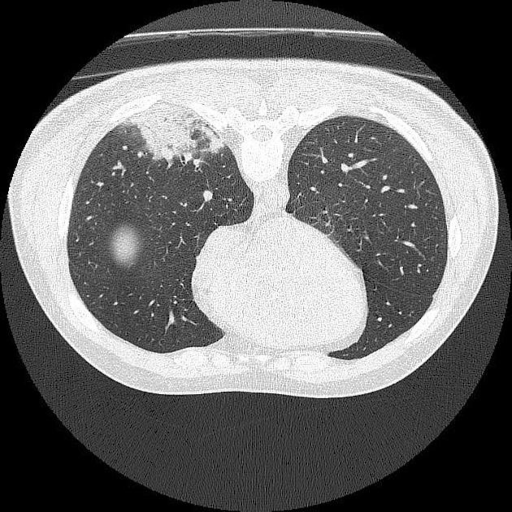</td>
<td></td>
<td>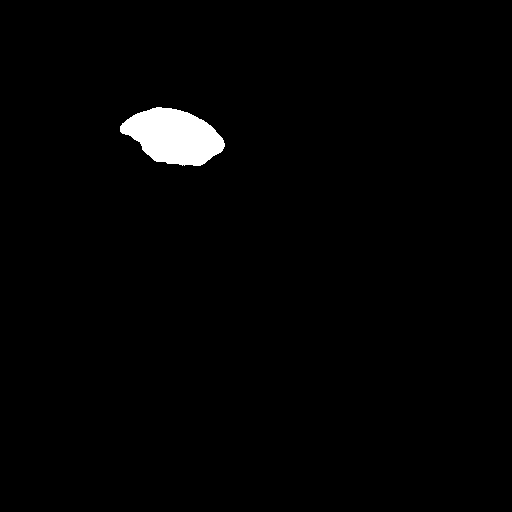</td>
</tr>
<tr>
<td>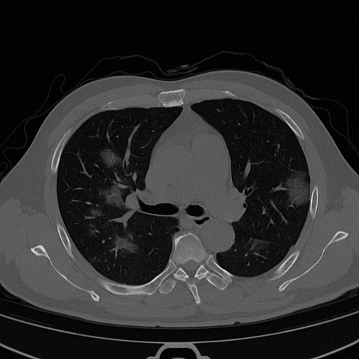</td>
<td>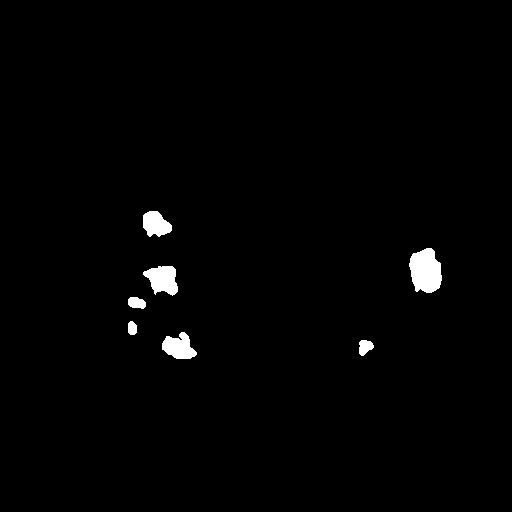</td>
<td>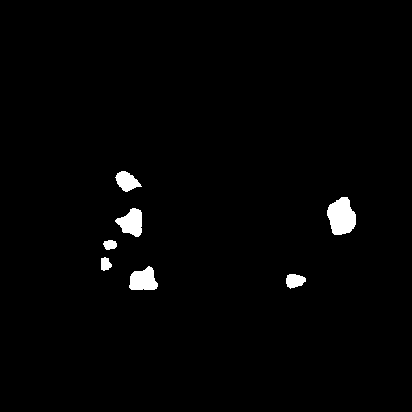</td>
</tr>
<tr>
<td>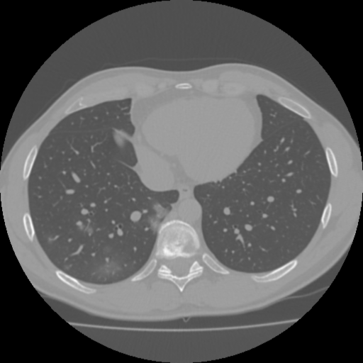</td>
<td>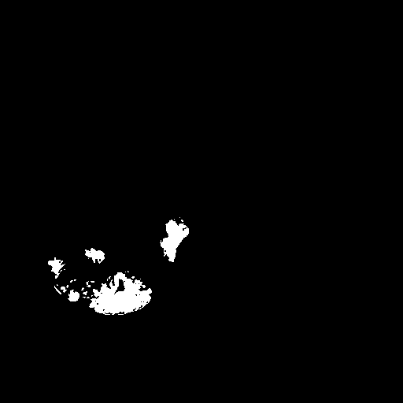</td>
<td></td>
</tr>
</table>

 
<h3>1. Dataset Citation</h3>
The dataset used here was taken from the following Kaggle:  
<a href="https://www.kaggle.com/datasets/piyushsamant11/pidata-new-names/data">
<b>Lung CT nodule/ Lesion Segmenbtation</b>
</a>  
<b>COVID-19+ Lung Cancer</b> 
by Piyush Samant DS.
  

The following explanation was taken the website above.
  
<b>About Dataset</b> 
This is the lung CT image dataset for lung nodule segmentation. 
The images in the dataset are selected from various publicly available datasets for COVID-19, 
lung cancer, and other lung-related abnormalities.
  
<b>License</b> 
Unknown
 
 
<h3>
2. Lung-Nodule-CT ImageMask Dataset
</h3>
<h3>2.1 Download ImageMask Dataset</h3>
 If you would like to train this Lung-Nodule-CT Segmentation model,
 please download the dataset from
<a href="https://www.kaggle.com/datasets/piyushsamant11/pidata-new-names/data">
<b>Lung CT nodule/ Lesion Segmenbtation</b>
</a>.
Please split it into test, train and valid subset by using a Python splitting tool
<a href="./tool/split_master.py">split_master.py</a>, and put it under the <b>./dataset</b> folder.
 
<pre>
./dataset
└─Lung-Nodule-CT
    ├─test
    │   ├─images
    │   └─masks
    ├─train
    │   ├─images
    │   └─masks
    └─valid
         ├─images
         └─masks
</pre>
 
<b>Lung-Nodule-CT Statistics</b> 
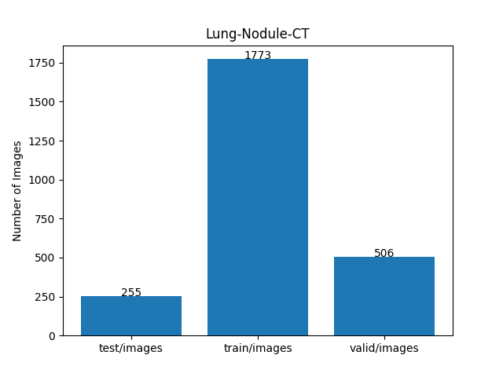 
 
As shown above, the number of images in the training and valid datasets is large enough to use for the
 training set of our segmentation model.
  
<h3>2.2 Train Sample Images and Masks</h3>
<b>Train_sample_images</b> 
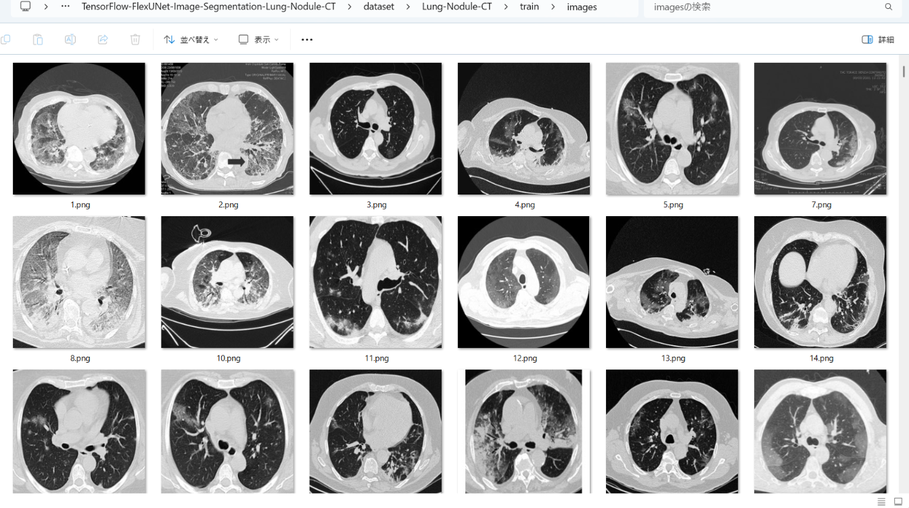
 
<b>Train_sample_masks</b> 
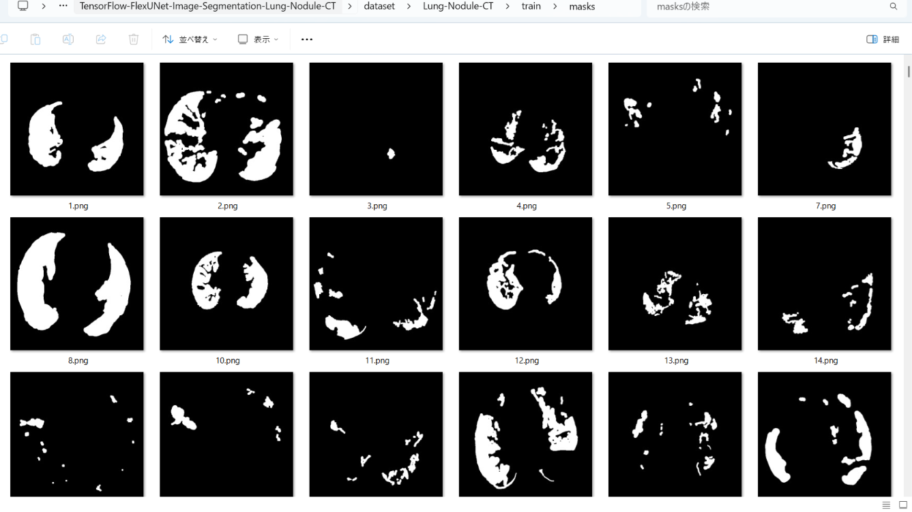
 
<h3>
3. Train TensorFlowFlexUNet Model
</h3>
 We trained the Lung-Nodule-CT TensorFlowFlexUNet model using the following
<a href="./projects/TensorFlowFlexUNet/Lung-Nodule-CT/train_eval_infer.config"> <b>train_eval_infer.config</b></a> file.  
Please move to ./projects/TensorFlowFlexUNet/Lung-Nodule-CT and run the following bat file. 
<pre>
>1.train.bat
</pre>
This runs the following command. 
<pre>
>python ../../../src/TensorFlowFlexUNetTrainer.py ./train_eval_infer.config
</pre>

<b>Model parameters</b> 
Defined a small <b>base_filters=16 </b> and large <b>base_kernels=(11,11)</b> for the first Conv Layer of Encoder Block of 
<a href="./src/TensorFlowFlexUNet.py">TensorFlowFlexUNet.py</a> 
and a large <b>num_layers=8</b> (including a bridge between Encoder and Decoder Blocks).
<pre>
[model]
; You may specify your own UNet class derived from our TensorFlowFlexModel
model         = "TensorFlowFlexUNet"
generator     =  False
image_width    = 512
image_height   = 512
image_channels = 3
num_classes    = 2
base_filters   = 16
base_kernels   = (11,11)
num_layers     = 8
dropout_rate   = 0.05
dilation       = (1,1)
</pre>
<b>Learning rate</b> 
Defined a small learning rate.  
<pre>
[model]
learning_rate  = 0.00007
</pre>
<b>Loss and metrics functions</b> 
Specified "categorical_focal_dice_loss" and <a href="./src/dice_coef_multiclass.py">"dice_coef_hybrid"</a>. 
<pre>
[model]
loss           = "categorical_focal_dice_loss"
metrics        = ["dice_coef_hybrid"]
hybrid_alpha   = 1.6
hybrid_beta    = 0.4
</pre>
<b>Dataset class</b> 
Specifed <a href="./src/ImageCategorizedMaskDataset.py">ImageCategorizedMaskDataset</a> class. 
<pre>
[dataset]
class_name    = "ImageCategorizedMaskDataset"
</pre>
 
<b>Learning rate reducer callback</b> 
Enabled the learning_rate_reducer callback and a small reducer_patience.
<pre> 
[train]
learning_rate_reducer = True
reducer_factor     = 0.4
reducer_patience   = 4
</pre>
<b>Early stopping callback</b> 
Enabled early stopping callback with the patience parameter.
<pre>
[train]
patience      = 10
</pre>
<b>RGB Color map</b> 
Specified RGB color map dict for Lung-Nodule-CT 2 classes. 
<pre>
[mask]
mask_datatype= "categorized"
mask_file_format = ".png"
; Lung-Nodule-CT RGB color map dict for 1+1 classes.
;      Background: black,  Nodule:white
rgb_map = {(0,0,0):0,(255,255,255):1,}
</pre>

<b>Epoch change inference callback</b> 
Enabled <a href="./src/EpochChangeInferencer.py">epoch_change_infer callback</a></b>. 
<pre>
[train]
epoch_change_infer       = True
epoch_change_infer_dir   =  "./epoch_change_infer"
num_infer_images         = 6
</pre>

By using this callback, on every epoch change, the inference procedure can be called
 for 6 images in the <b>mini_test</b> folder. This will help you confirm how the predicted mask changes 
 at each epoch during your training process.  
  
<!--
As shown below, early in the model training, the predicted masks from our FlexUNet segmentation model showed 
discouraging results.
 However, as training progressed through the epochs, the predictions gradually improved. 
   
 
-->
<b>Epoch_change_inference output at starting (epoch 1,2,3)</b> 
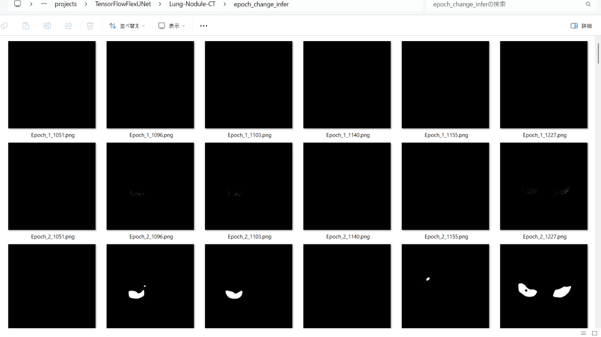 
 
<b>Epoch_change_inference output at middlepoint (epoch 18,19,20)</b> 
 
 
<b>Epoch_change_inference output at ending (epoch 37,38,39)</b> 
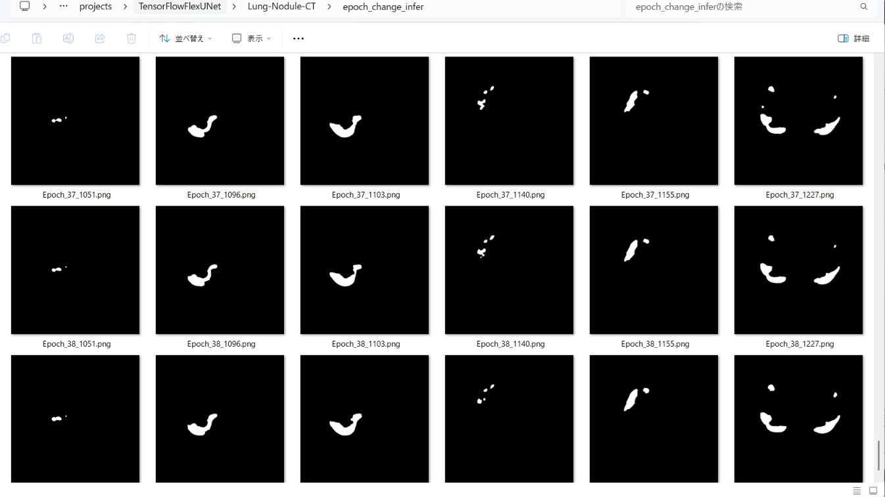 
 
In this experiment, the training process was stopped at epoch 39 by EarlyStoppingCallback. 
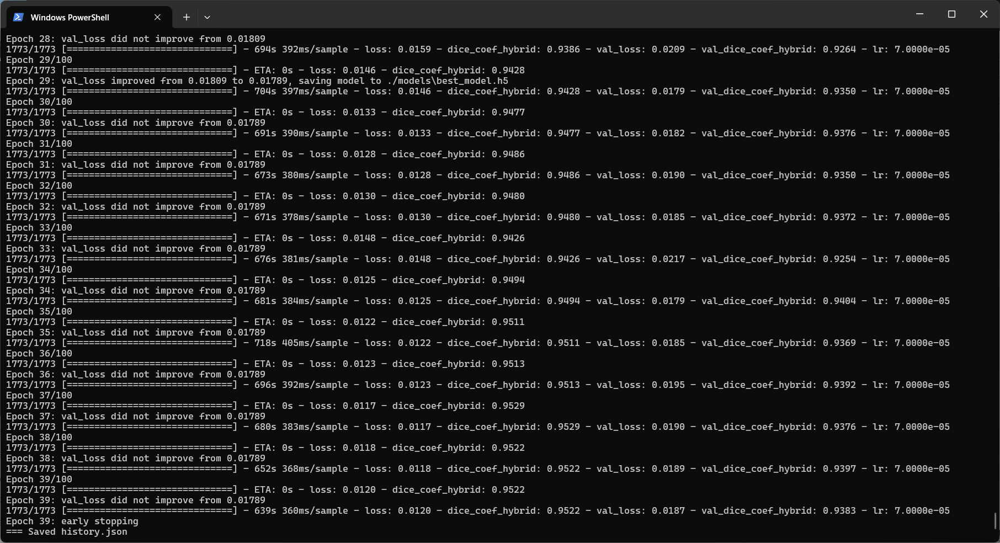 
 
<a href="./projects/TensorFlowFlexUNet/Lung-Nodule-CT/eval/train_metrics.csv">train_metrics.csv</a> 
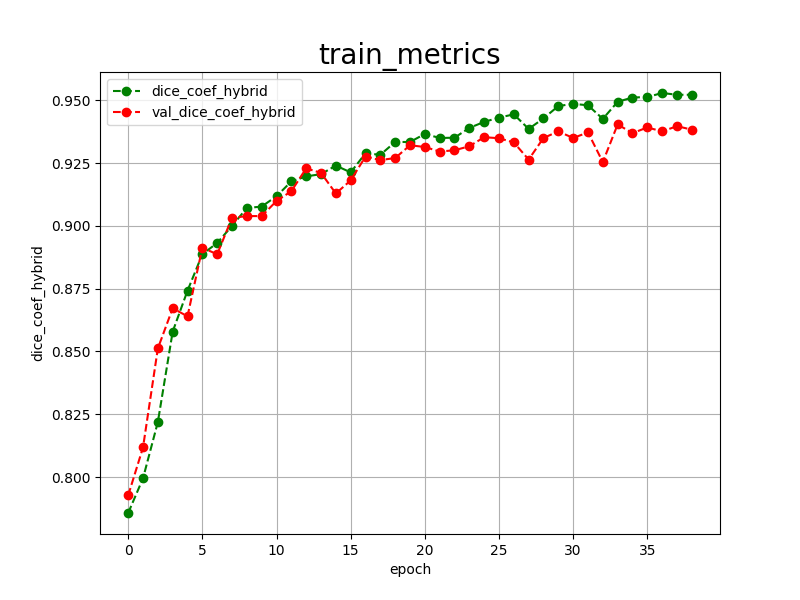 
 
<a href="./projects/TensorFlowFlexUNet/Lung-Nodule-CT/eval/train_losses.csv">train_losses.csv</a> 
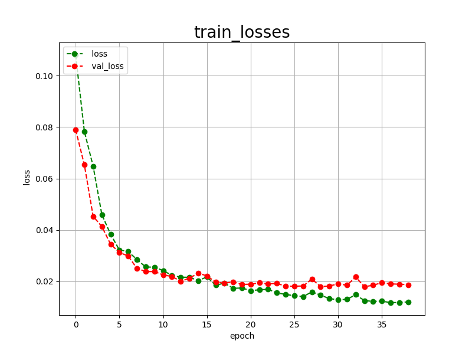 
 
<h3>
4. Evaluation
</h3>
Please move to <b>./projects/TensorFlowFlexUNet/Lung-Nodule-CT</b> folder,
and run the following bat file to evaluate the TensorFlowUNet model for Lung-Nodule-CT. 
<pre>
>./2.evaluate.bat
</pre>
This runs the following command.
<pre>
>python ../../../src/TensorFlowFlexUNetEvaluator.py ./train_eval_infer.config
</pre>

Evaluation console output: 
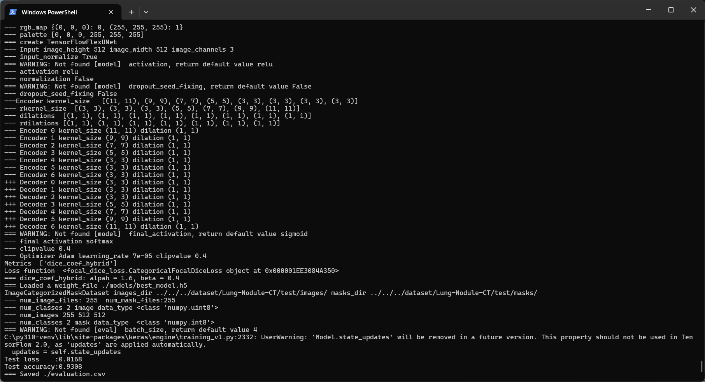
  Image-Segmentation-Lung-Nodule-CT

<a href="./projects/TensorFlowFlexUNet/Lung-Nodule-CT/evaluation.csv">evaluation.csv</a> 
The loss (categorical_focal_dice_loss) on this Lung-Nodule-CT/test was low, and dice_coef_hybrid was high, as shown below.
 
<pre>
categorical_focal_dice_loss,0.0168
dice_coef_hybrid,0.9308
</pre>
 
<h3>
5. Inference
</h3>
Please move to <b>./projects/TensorFlowFlexUNet/Lung-Nodule-CT</b> folder
and run the following bat file to infer segmentation regions for images using the trained TensorFlowUNet model for Lung-Nodule-CT. 
<pre>
>./3.infer.bat
</pre>
This runs the following command.
<pre>
>python ../../../src/TensorFlowFlexUNetInferencer.py ./train_eval_infer.config
</pre>

<b>mini_test_images</b> 
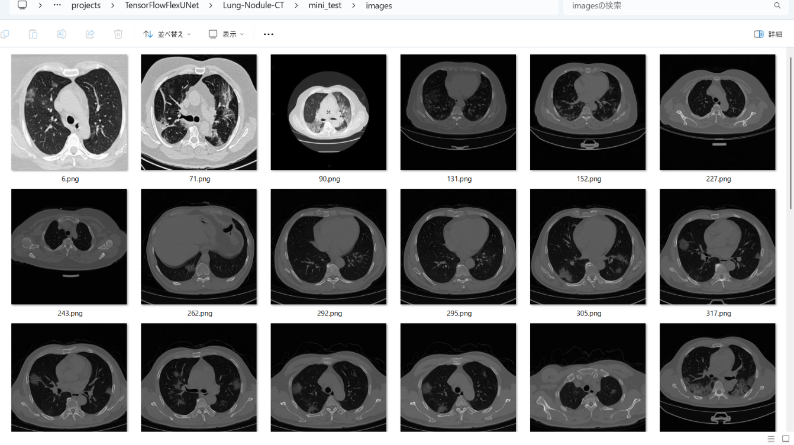 
<b>mini_test_mask(ground_truth)</b> 
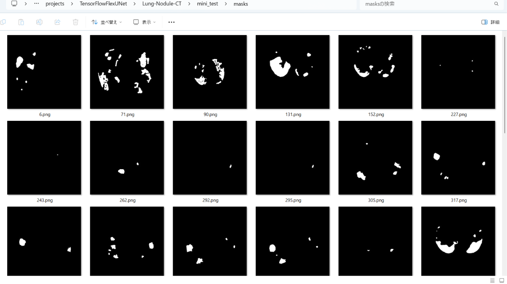 

<b>Inferred test masks</b> 
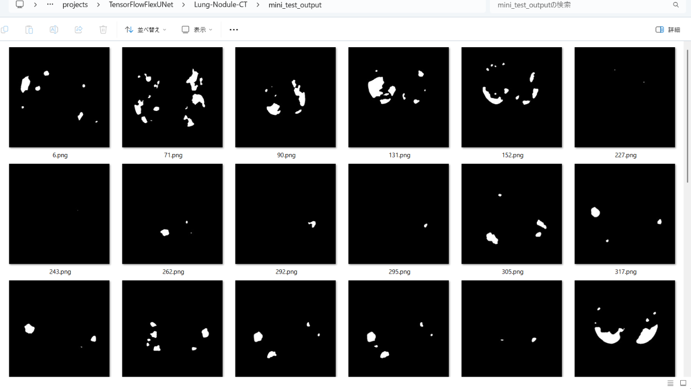 
 

<b>Enlarged images and masks for Lung-Nodule-CT Images of 512x512 pixels</b> 
As shown below, the inferred masks look similar to the ground truth masks except for the first 
and fifth cases. 
 
<table>
<tr>
<th width="320" height="auto">Image</th>
<th width="320" height="auto">Mask (ground_truth)</th>
<th width="320" height="auto">Inferred-mask</th>
</tr>
<tr>
<td>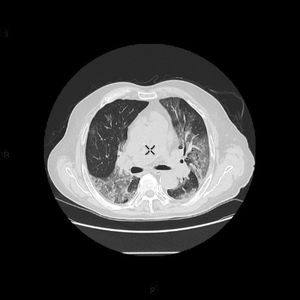</td>
<td>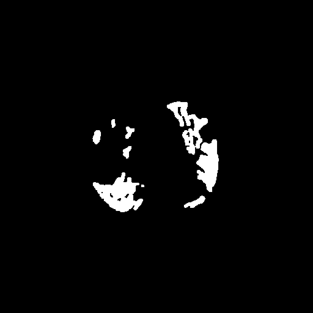</td>
<td></td>
</tr>
<tr>
<td>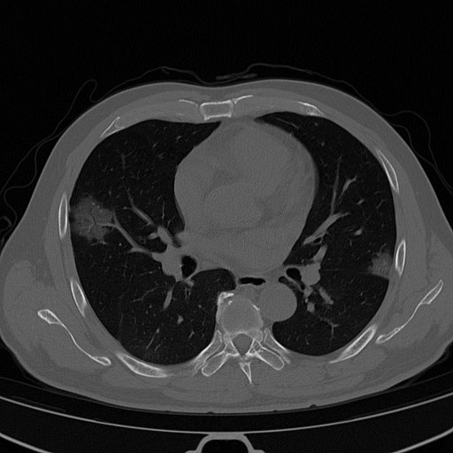</td>
<td>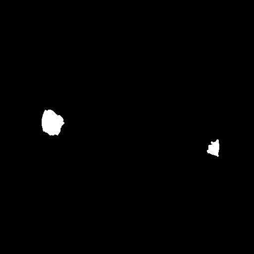</td>
<td>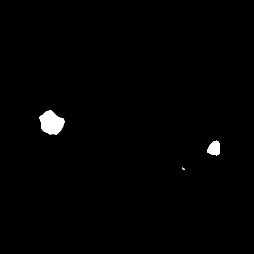</td>
</tr>
<tr>
<td>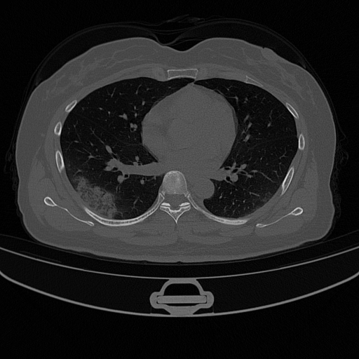</td>
<td>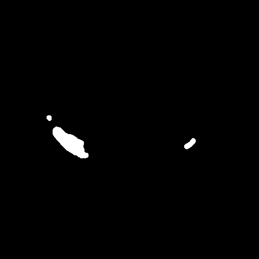</td>
<td>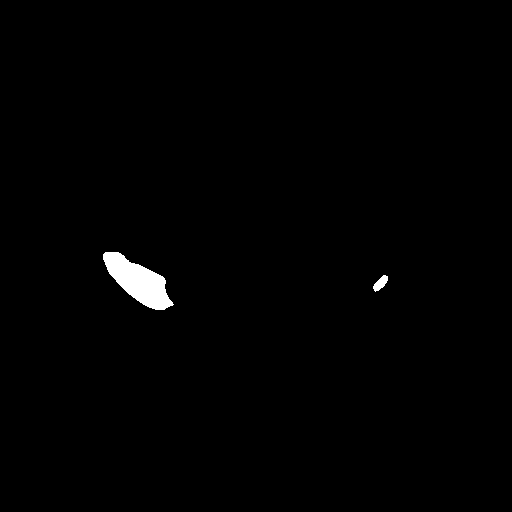</td>
</tr>
<tr>
<td>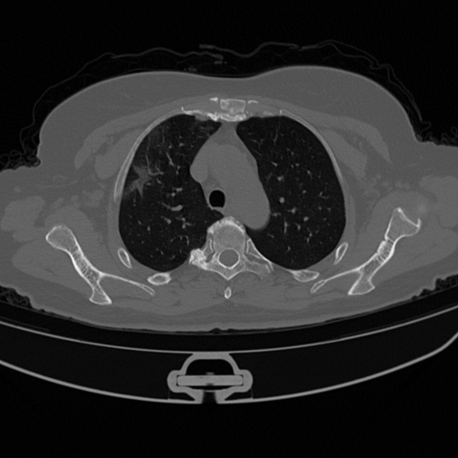</td>
<td>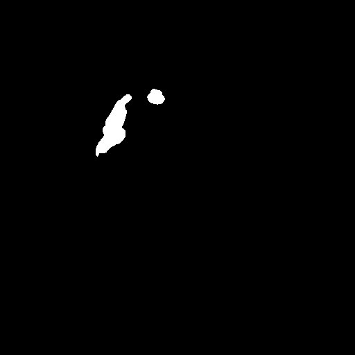</td>
<td>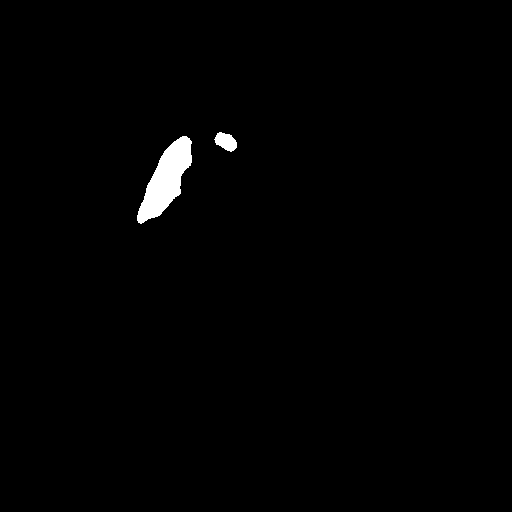</td>
</tr>
<tr>
<td>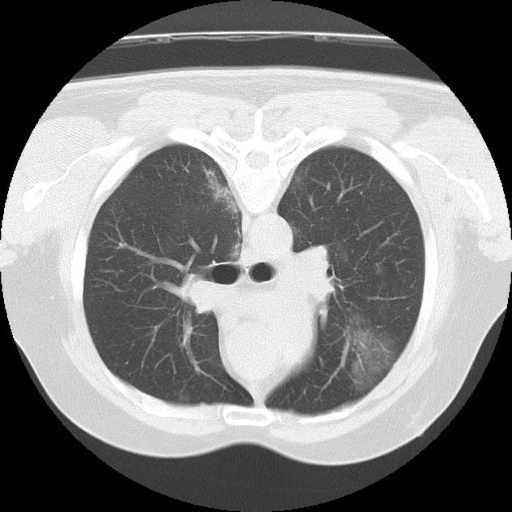</td>
<td>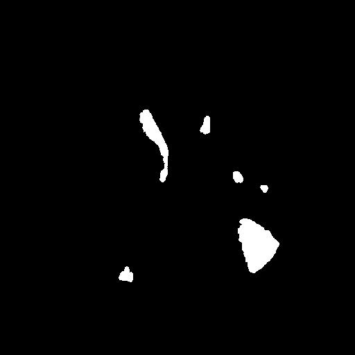</td>
<td>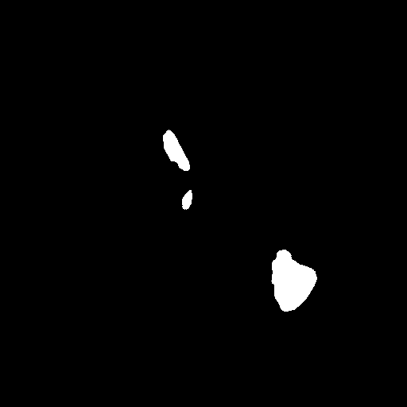</td>
</tr>
<tr>
<td>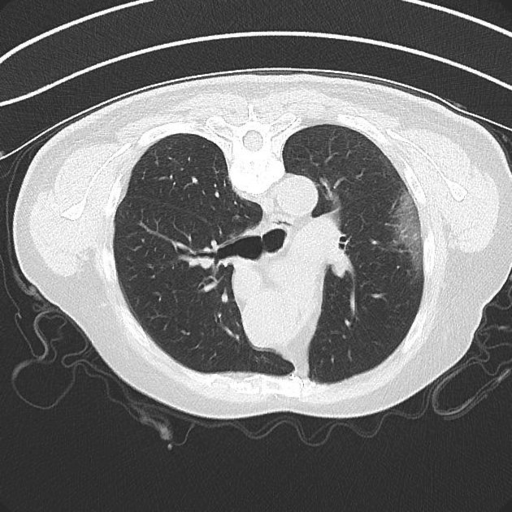</td>
<td></td>
<td>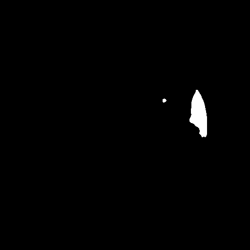</td>
</tr>
</table>

 
<h3>
References
</h3>
<b>1. Lung cancer segmentation dataset with Lung-RADS class</b> 
Nam, Diana; Panina, Alexandra; Pak, Alexandr  
(2024),  Mendeley Data, V1, doi: 10.17632/5rr22hgzwr.1  
<a href ="https://data.mendeley.com/datasets/5rr22hgzwr/1">
  https://data.mendeley.com/datasets/5rr22hgzwr/1
</a>
  
<b>2. Lung Tumor Image Segmentation from Computer Tomography Images Using MobileNetV2 and Transfer Learning</b> 
Zainab Riaz, Bangul Khan, Saad Abdullah, Samiullah Khan, Md Shohidul Islam 
<a href="https://pmc.ncbi.nlm.nih.gov/articles/PMC10451633/" >
  https://pmc.ncbi.nlm.nih.gov/articles/PMC10451633/
</a>
  
<b>3. NLSTseg: A Pixel-level Lung Cancer Dataset Based on NLST LDCT Images</b> 
Kun-Hui Chen, Yi-Hui Lin, Shawn Wu, Nai-Wen Shih, Hsing-Chen Meng, Yen-Yu Lin, Chun-Rong Huang & Jing-Wen Huang  
<a href ="https://www.nature.com/articles/s41597-025-05742-x">
https://www.nature.com/articles/s41597-025-05742-x
</a>
  
<b>4. TensorFlow-FlexUNet-Image-Segmentation-Smokers-Lung-Cancer-CT</b> 
Toshiyuki Arai 
<a href="https://github.com/sarah-antillia/TensorFlow-FlexUNet-Image-Segmentation-Smokers-Lung-Cancer-CT">
https://github.com/sarah-antillia/TensorFlow-FlexUNet-Image-Segmentation-Smokers-Lung-Cancer-CT
</a>
  
<b>5. TensorFlow-FlexUNet-Image-Segmentation-Lung-Cancer-CT</b> 
Toshiyuki Arai 
<a href="https://github.com/sarah-antillia/TensorFlow-FlexUNet-Image-Segmentation-Lung-Cancer-CT">
https://github.com/sarah-antillia/TensorFlow-FlexUNet-Image-Segmentation-Lung-Cancer-CT
</a>
  
<b>6. TensorFlow-FlexUNet-Image-Segmentation-Model</b> 
Toshiyuki Arai 
<a href="https://github.com/sarah-antillia/TensorFlow-FlexUNet-Image-Segmentation-Model">
https://github.com/sarah-antillia/TensorFlow-FlexUNet-Image-Segmentation-Model
</a>
  
